<div align="center">

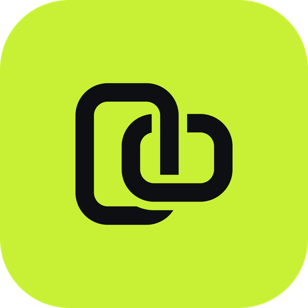

# bridge

### **Android and Mac, seamlessly connected.**

A lightweight, native open-source bridge linking your **Android phone** and your **Mac** over your local Wi-Fi network—with zero cloud accounts, zero telemetry, and zero latency.

<p align="center">
  
  
  
  
  <a href="LICENSE"></a>
</p>

<p align="center">
  <a href="#-whats-new-in-v140">What's New in v1.4.0</a> •
  <a href="#-key-features">Key Features</a> •
  <a href="#-getting-started">Getting Started</a> •
  <a href="#-pairing--multi-device-connection">Pairing & Multi-Device</a> •
  <a href="#-security-privacy--architecture-transparency">Security & Privacy</a>
</p>

<table align="center">
  <tr>
    <td align="center"><b>macOS Menu Bar App (Local File Sharing & Transfer)</b></td>
    <td align="center"><b>Android App (3-Tab Floating Pill Navigation)</b></td>
  </tr>
  <tr>
    <td align="center">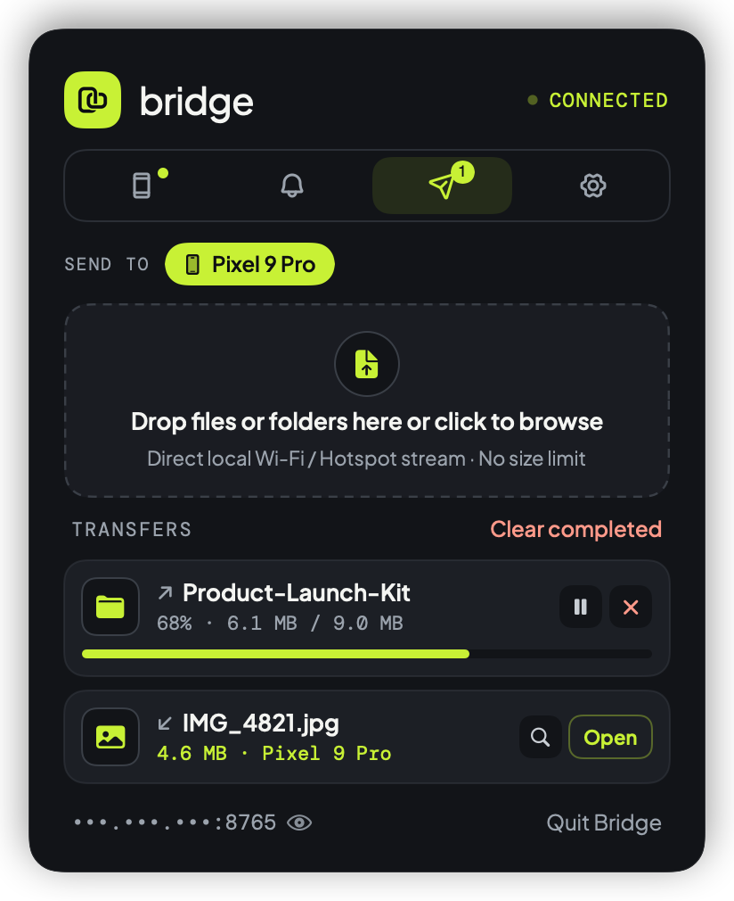</td>
    <td align="center">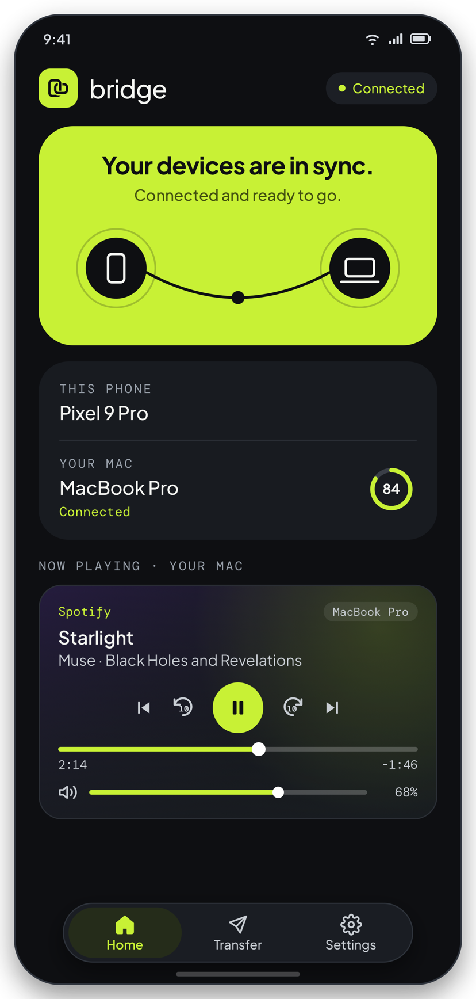</td>
  </tr>
</table>

</div>

---

> [!NOTE]
> **Active Open-Source Project**  
> Bridge is an actively maintained open-source project updated on a regular basis with continuous stability enhancements, new features, and design improvements. Star the repository to follow releases and upcoming roadmap milestones.

---

## ⚡ What's New in v1.4.0

Bridge **v1.4.0** introduces pure in-app Android-to-Mac phone mirroring, native-style macOS call notifications with live call duration, bidirectional media & device controls, and Android 14 clipboard reliability fixes:

- **In-App Phone Mirroring (Zero ADB Required)** — Stream your phone's display via hardware H.264 (`MediaProjection` → Apple `VideoToolbox`) into a borderless iPhone Mirroring-style macOS window with hover-reveal controls, trackpad swipes, Mac keyboard input (`⌘C`, `⌘X`, `⌘V`, `⌘A`, `⌘1`–`⌘4`), auto-hidden phone keyboard, and physical phone screen dimming—secured end-to-end with one-way SHA-256 handshake proofs and per-frame **AES-256-GCM** encryption.
- **Calls on Mac with Live Duration & Multi-App Controls** — Displays real caller names from cellular calls and VoIP apps (Telegram, Messenger, WhatsApp) in a native macOS Notification Center frosted banner with a live `MM:SS` timer, **Accept**, **Decline**, **Silence**, and active **Mute / End Call** buttons, plus automatic pause for playing Mac media.
- **Bidirectional Universal Now Playing & Remote Device Controls** — View and control Android media from your Mac, or control universal Mac media playback (bundled `MediaRemoteAdapter`, Spotify, Apple Music, VLC, and browser YouTube tabs), Mac mute/volume, and live Mac battery telemetry directly from Android.
- **Quick Controls, Low-Battery Alerts, Launch at Login & Clipboard Sync Fixes** — Added remote **Sound / Vibrate / Silent**, **DND**, and **Ring Phone** beacon controls, optional ≤ 15% phone low-battery alerts, macOS Launch at Login, and reliable Android 13/14 / One UI 6 background copy sync.

---

## ✨ Key Features

### 📁 High-Speed Encrypted Local File & Folder Sharing
* **Unlimited Transfers:** Transfer single files, batches, or full directory structures directly between Mac and Android with zero file size limits.
* **Direct LAN Stream:** Transfers stream straight across your local network or hotspot with hardware-accelerated AES-GCM encryption and post-transfer SHA-256 verification.
* **Folder Structure Integrity:** Directories are packaged cleanly without OS metadata (`.DS_Store`, `__MACOSX`, `Thumbs.db`) using fast deflate compression.
* **Native OS Shortcuts:** Drag and drop onto the macOS menu bar icon, right-click in Finder to "Share with Bridge", or share from Android's system share sheet (`ACTION_SEND`).
* **Custom Save Locations:** Choose your custom downloads folder on both Mac (via persistent Security-Scoped Bookmarks) and Android (via Storage Access Framework).

<br/>
<table align="center">
  <tr>
    <td align="center"><b>macOS Menu Bar Transfer</b></td>
    <td align="center"><b>Android Transfer Tab</b></td>
  </tr>
  <tr>
    <td align="center"></td>
    <td align="center">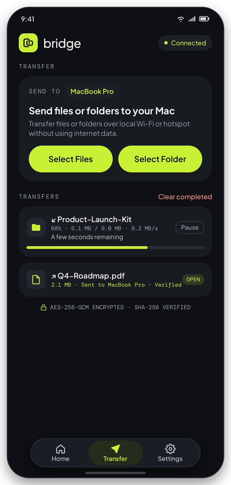</td>
  </tr>
</table>

### 📋 Two-Way Clipboard Synchronization (Text & Photos)
* **Instant Text Copy:** Copy any text, code snippet, or link on your phone or Mac; immediately paste it on the other device with zero extra taps.
* **Screenshot & Image Sync:** Copy an image in Preview, capture a macOS screenshot (`Cmd+Shift+4`), or copy a photo on Android—it syncs directly into the other device's pasteboard.
* **Echo Suppression:** Robust SHA-256 digest hashing prevents infinite clipboard feedback loops.

<br/>
<div align="center">
  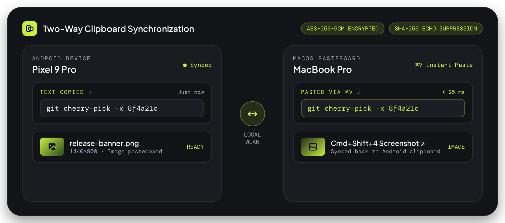
</div>

### 🔔 Interactive Notification Mirroring
* **Instant Forwarding:** Phone notifications appear instantly in the macOS menu bar popover and as native macOS notification banners with app icons.
* **Inline Quick Reply:** Type and send replies directly to messages without touching your phone.
* **Smart Filtering:** Persistent background services and duplicate group summaries are automatically filtered out to keep your Mac feed clean.
* **Bidirectional Settings Sync:** Toggle notification sync on either phone or Mac with changes synchronized across both devices in real time.
* **Mac Alert Mirroring:** Optionally forward Mac system notifications to your Android device with smart duplicate detection (drops alerts for apps already installed on your phone).

<br/>
<div align="center">
  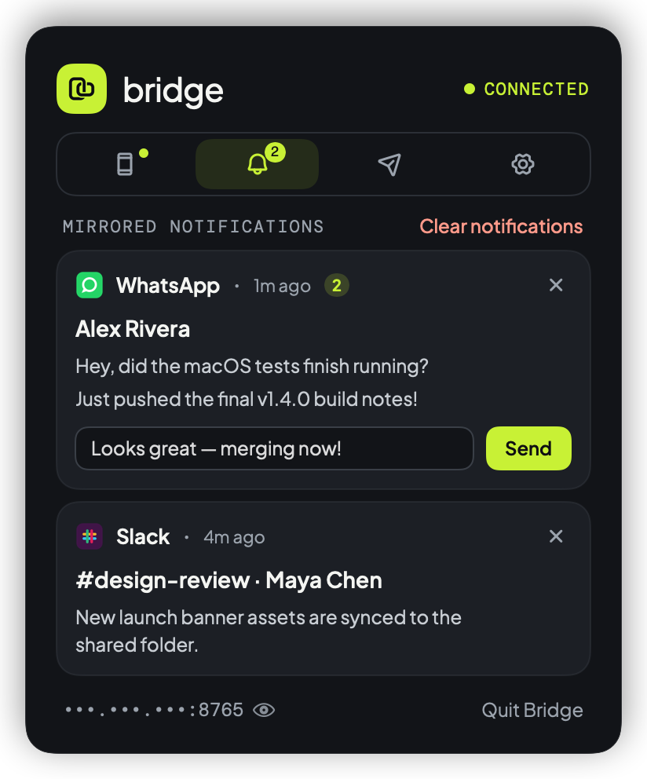
</div>

### ⚡ Seamless Local Connectivity
* **Zero-Config Bonjour Discovery:** Discovers your Mac automatically on Wi-Fi via mDNS (`_clipboardsync._tcp`), adapting seamlessly to DHCP router changes.
* **Sleep & Wake Resilience:** Automatically pauses when your MacBook lid closes and re-establishes the connection within 1.5 seconds upon waking.
* **100% Local Wi-Fi:** All communication travels strictly over your local router on `TCP :8765`. Zero cloud servers, zero third-party accounts, zero tracking.

<br/>
<div align="center">
  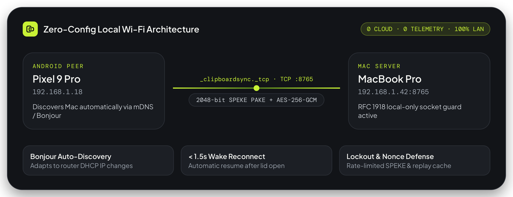
</div>

### 📱 Multiple Device Connectivity
* **One Mac, Multiple Phones:** Keep your personal and work phones linked to your MacBook at the same time.
* **Unified Feed:** Notifications from both devices are displayed with individual device tags.
* **Selective Unpairing:** Unpair or disconnect one phone without affecting other active devices.

<br/>
<div align="center">
  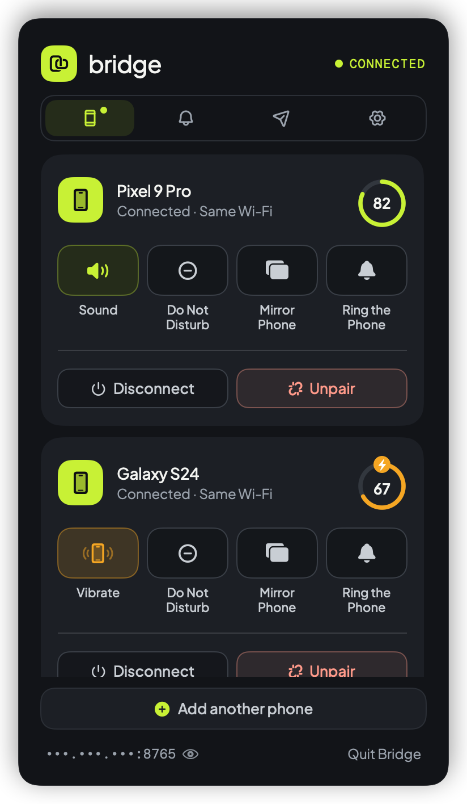
</div>

### 🖥️ In-App Phone Mirroring
* **Native Hardware Streaming:** Mirrors your Android display in real time over local Wi-Fi using `MediaProjection` + H.264 `MediaCodec` on Android and hardware `VideoToolbox` decoding on Mac—without needing USB cables or ADB setup.
* **iPhone Mirroring-Style Window:** Borderless resizable bezel window with a hover-reveal top pill (`Screen Dim`, `Pin on Top`, `Back`, `Home`, `Recents`) and automatic rotation handling.
* **Mac Trackpad & Keyboard Control:** Click, drag, long-press, scroll with two-finger trackpad swipes, and type directly from your Mac keyboard (`⌘V`, `⌘C`, `⌘X`, `⌘A`, plus `⌘1` Home, `⌘2` Recents, `⌘3` Back, `⌘4` Notifications) while keeping the phone screen dimmed and awake.

<br/>
<div align="center">
  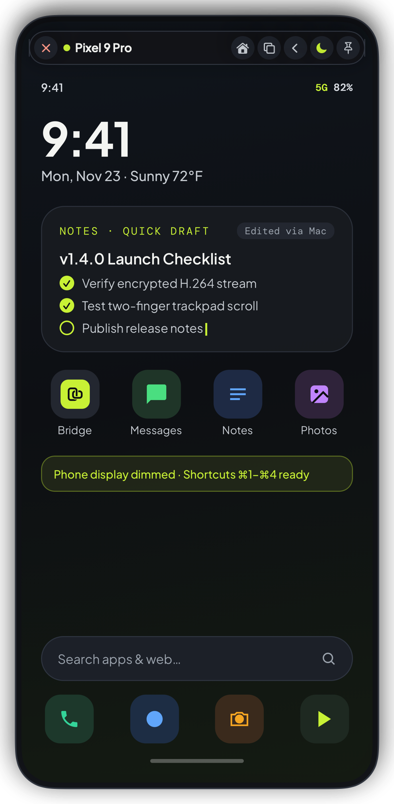
</div>

### 📞 Calls on Mac & Auto-Pause Media
* **Native macOS Call Banner:** Incoming cellular calls and messaging calls (Telegram, Messenger, WhatsApp) surface in a frosted-glass macOS Notification Center banner showing the resolved caller name, app icon, and a live `MM:SS` duration counter once answered.
* **Full Call Controls:** **Accept**, **Decline**, or **Silence** ringing calls, and **Mute / Unmute** or **End Call** while active.
* **Auto-Pause Mac Media:** Optionally pauses active audio/video on your Mac when a call arrives on your phone.

<br/>
<div align="center">
  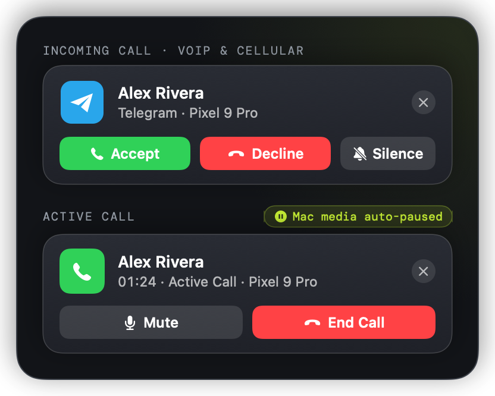
</div>

### 🎵 Bidirectional Media & Device Controls
* **Universal Now Playing Sync:** Control active Android media from Mac, or view album art, seek timelines, skip tracks (`±10s`, previous/next), and control Mac audio across Spotify, Apple Music, VLC, browsers, and any Now Playing app from your phone.
* **Live Telemetry & Quick Toggles:** View live battery percentages & charging status on both devices, receive optional ≤ 15% low-battery alerts on Mac, toggle phone ringer mode (`Sound` / `Vibrate` / `Mute`), Do Not Disturb, Mac mute/volume, or trigger a high-audibility **Ring Phone** beacon.

<br/>
<table align="center">
  <tr>
    <td align="center"><b>Android Controls & Now Playing on Mac</b></td>
    <td align="center"><b>Mac Controls & Now Playing on Android</b></td>
  </tr>
  <tr>
    <td align="center">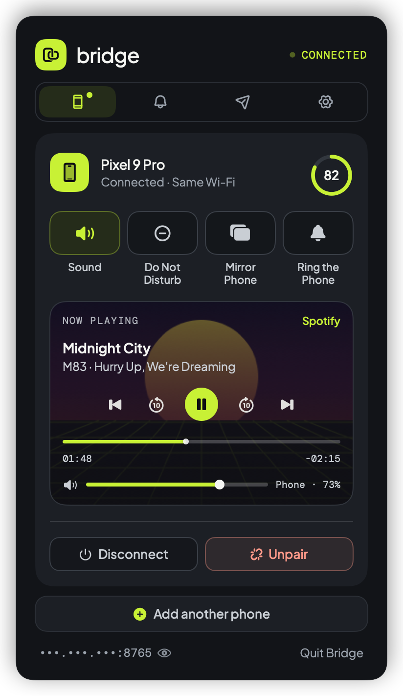</td>
    <td align="center"></td>
  </tr>
</table>

---

## 🚀 Getting Started

You can install Bridge from [**GitHub Releases**](../../releases), via terminal commands (`adb` / `curl`), or by building from source.

### 1. Install on macOS (`macOS 13.0+`)

**Option A — Drag-and-Drop `.dmg` Installer (Recommended):**
1. Download **`Bridge-v*-macOS.dmg`** from the latest [**GitHub Release**](../../releases).
2. Double-click the downloaded **`.dmg`** file and drag **`Bridge.app`** into the **Applications** folder in the installer window, then eject the **Bridge** installer drive.
3. Launch **`Bridge.app`**. *(If macOS Gatekeeper prompts on first launch, right-click `Bridge.app` → **Open**, or run `xattr -cr /Applications/Bridge.app && open /Applications/Bridge.app` in Terminal).*
4. The Bridge icon will appear in your top menu bar.

**Option B — Install via Terminal (CLI):**
```bash
TAG=$(curl -fsSL https://api.github.com/repos/badruddin-tasnim/bridge/releases/latest | grep -m1 '"tag_name"' | cut -d'"' -f4)
curl -L -o /tmp/Bridge-macOS.dmg "https://github.com/badruddin-tasnim/bridge/releases/download/${TAG}/Bridge-${TAG}-macOS.dmg"
hdiutil attach -nobrowse -quiet /tmp/Bridge-macOS.dmg
rm -rf /Applications/Bridge.app && cp -R /Volumes/Bridge/Bridge.app /Applications/Bridge.app
hdiutil detach /Volumes/Bridge -quiet
xattr -cr /Applications/Bridge.app
open /Applications/Bridge.app
```

---

### 2. Install on Android (`Android 8.0+`)

> [!NOTE]
> **Play Protect & Restricted Settings on Direct APK Installs:**
> Bridge is a 100% open-source, non-Play utility that declares `BIND_NOTIFICATION_LISTENER_SERVICE` (to mirror notifications and send inline replies) and `BIND_ACCESSIBILITY_SERVICE` (to detect clipboard copy events in the background on Android 10+).
>
> When downloading the APK directly on your phone, Google Play Protect may display a *"Harmful app blocked"* warning—tap **Install anyway** to proceed, then enable **Allow restricted settings** under App Info so Android lets you turn on Notification Access and Accessibility. Installing over **USB with `adb`** also works and skips Android 13+'s *Restricted settings* prompt automatically (useful if Enhanced Fraud Protection hides *"Install anyway"* on a specific device/region).

#### Method A: Direct APK Download on Phone *(Recommended — No Cable Needed)*

1. Download **`Bridge-v*-Android.apk`** from [**GitHub Releases**](../../releases) directly on your Android phone.
2. Open the downloaded **`.apk`** file to install it. If Google Play Protect shows a *"Harmful app blocked"* warning, tap **Install anyway** *(or **More details → Install anyway**)*.
3. **Allow Restricted Settings (Android 13+):** After sideloading an APK directly, Android initially disables **Accessibility** and **Notification Access** with a *"Restricted setting"* notice (*"For your security, this setting is unavailable"*):
   - Tap either **Notification Access** or **Accessibility** once inside Bridge so Android registers the permission request.
   - Open your phone's **Settings → Apps → Bridge → ⋮ (top right / More options) → Allow restricted settings**, then confirm with your PIN or biometrics.
   - Return to Bridge and enable **Notification Access** and **Background Clipboard Service (Accessibility)**.

#### Method B: Install via USB & ADB from Your Mac *(Alternative — Auto-Unlocks Restricted Settings)*

1. **Enable USB Debugging on your Android phone:**
   - Open **Settings → About phone** and tap **Build number** 7 times until *"You are now a developer!"* appears.
   - Open **Settings → System → Developer options** (or **Additional settings → Developer options**) and enable **USB debugging**.
2. **Connect your phone to your Mac via USB cable** and tap **Allow** on the *"Allow USB debugging?"* prompt on your phone.
3. **Run the following commands in your Mac Terminal:**
   ```bash
   # Install adb if you don't already have it
   brew install --cask android-platform-tools

   # Download the latest Bridge Android APK and install over USB
   TAG=$(curl -fsSL https://api.github.com/repos/badruddin-tasnim/bridge/releases/latest | grep -m1 '"tag_name"' | cut -d'"' -f4)
   curl -L -o /tmp/Bridge-Android.apk "https://github.com/badruddin-tasnim/bridge/releases/download/${TAG}/Bridge-${TAG}-Android.apk"
   adb install -r /tmp/Bridge-Android.apk
   ```

---

### 3. Build from Source

<details>
<summary><b>Click to expand build instructions (Swift & Gradle)</b></summary>

#### Prerequisites
- **macOS:** macOS 13.0+ with Xcode Command Line Tools (`xcode-select --install`)
- **Android:** JDK 17+ and Android SDK (`compileSdk 34`)

#### Build macOS Menu Bar App
```bash
cd mac-app
make clean && make
make install   # Installs Bridge.app to /Applications/Bridge.app
make run       # Launches Bridge in your menu bar
make dmg       # Packages a drag-to-Applications Bridge-macOS.dmg installer
```

#### Build Android App
```bash
cd android-app
./gradlew assembleDebug
adb install -r app/build/outputs/apk/debug/app-debug.apk
```
</details>

### Verify Release Downloads

All official release assets include `SHA256SUMS.txt` on the GitHub Release page. Starting in `v1.3.2`, release APKs are also signed with Bridge's dedicated Android release certificate:

```bash
# 1. Verify archive & APK checksums against SHA256SUMS.txt
shasum -a 256 -c SHA256SUMS.txt

# 2. Verify the Android APK signing certificate SHA-256 fingerprint
apksigner verify --print-certs Bridge-*-Android.apk
```

Expected Android signing certificate SHA-256 digest:

```text
AC:40:63:01:B9:1F:9D:49:65:8D:37:12:3D:4C:D6:A7:F7:91:13:2C:D7:BB:3A:3F:51:F5:60:BD:60:B9:77:DC
```

---

## 🔗 Pairing & Multi-Device Connection

Pairing your devices is fast, private, and requires zero account creation:

<table align="center">
  <tr>
    <td align="center" width="50%"><b>Step 1: Open Mac Menu Bar</b></td>
    <td align="center" width="50%"><b>Step 2: Scan QR or Enter Code on Phone</b></td>
  </tr>
  <tr>
    <td align="center">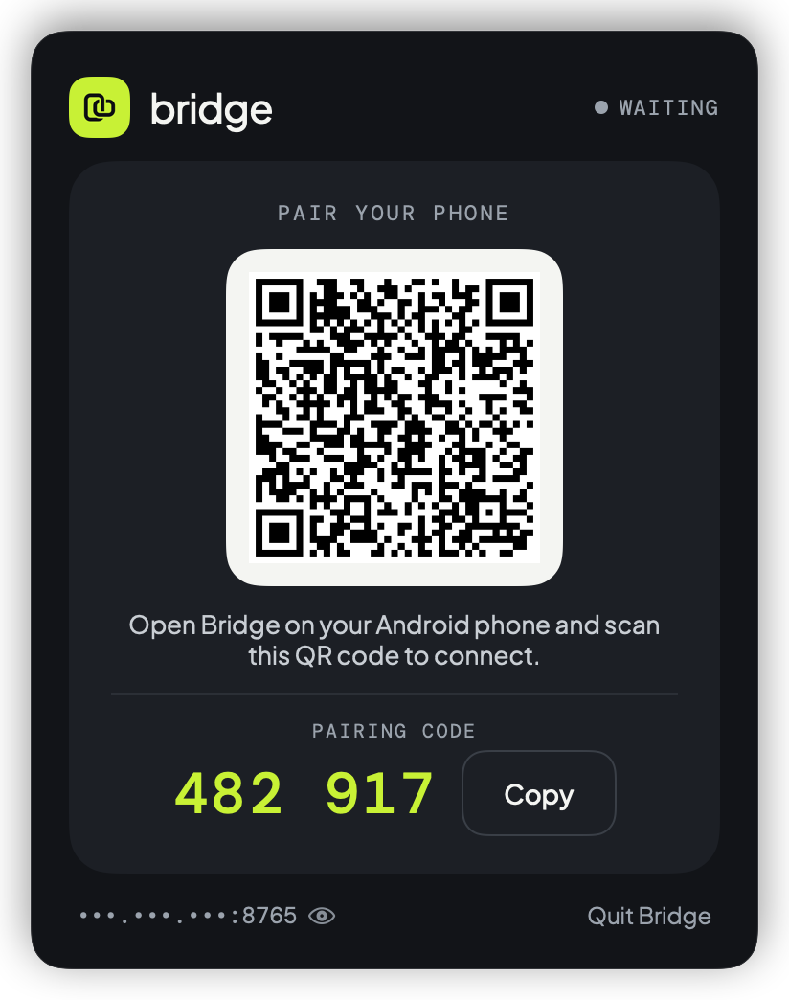</td>
    <td align="center">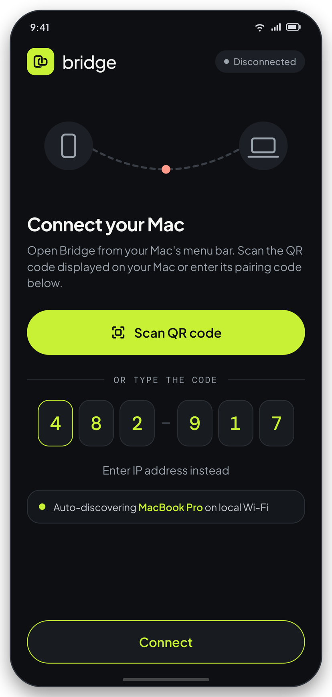</td>
  </tr>
  <tr>
    <td align="center" width="50%"><b>Step 3: Permissions & Device Controls</b></td>
    <td align="center" width="50%"><b>Step 4: Connected & Ready</b></td>
  </tr>
  <tr>
    <td align="center">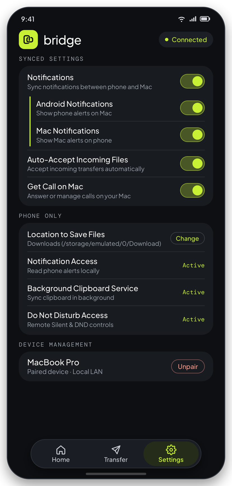</td>
    <td align="center">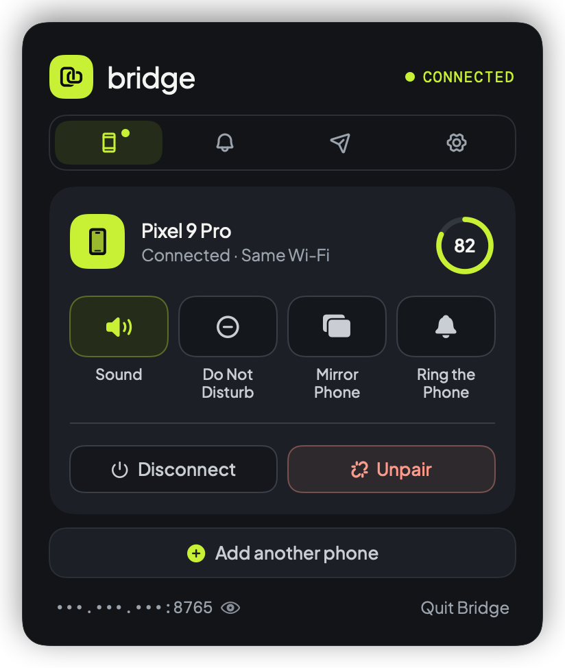</td>
  </tr>
</table>

### Step-by-Step Instructions:

1. **Connect to Same Wi-Fi:** Ensure your Android phone and Mac are connected to the same local Wi-Fi network. *(Tip: When traveling or away from home, you can also connect your Mac directly to your phone's Personal Hotspot).*
2. **Open Bridge on Mac:** Click the **Bridge** icon in your Mac menu bar. It displays your instant QR code and 6-digit code.
3. **Scan or Type Code on Android:**
   - Tap **Scan QR code** in the Android app and point your camera at the Mac menu bar popover.
   - *Alternatively:* Enter the 6-digit pairing code shown on your Mac.
   - *Manual IP:* If on an enterprise network blocking multicast (mDNS), tap **Enter IP address instead** and click the eye icon in the bottom bar of the Mac popover to view your `IP:port`.
4. **Grant Permissions on Android:**
   - **Notification Access:** Allows Bridge to mirror your incoming notifications, live calls, and route quick replies or call actions.
   - **Accessibility Service:** Android 10+ restricts background apps from reading the clipboard. Bridge uses accessibility events to capture copy actions and dispatch gestures/text when Phone Mirroring is active.
   - **Battery Optimization Exemption:** Prevents OEM task killers from freezing background sync when your phone is locked.
   - **Phone & Screen Capture *(Optional, for Calls & Mirroring)*:** Prompted when enabling **Calls on Mac** (`ANSWER_PHONE_CALLS` / `READ_PHONE_STATE`) or starting a **Mirror Phone** session (`MediaProjection`).
5. **Adding Another Phone:**
   - Click **Add another phone** in the Mac popover anytime.
   - The QR drawer expands smoothly without disconnecting your existing device.
   - Scan with your second device to link both phones simultaneously!

<div align="center">
  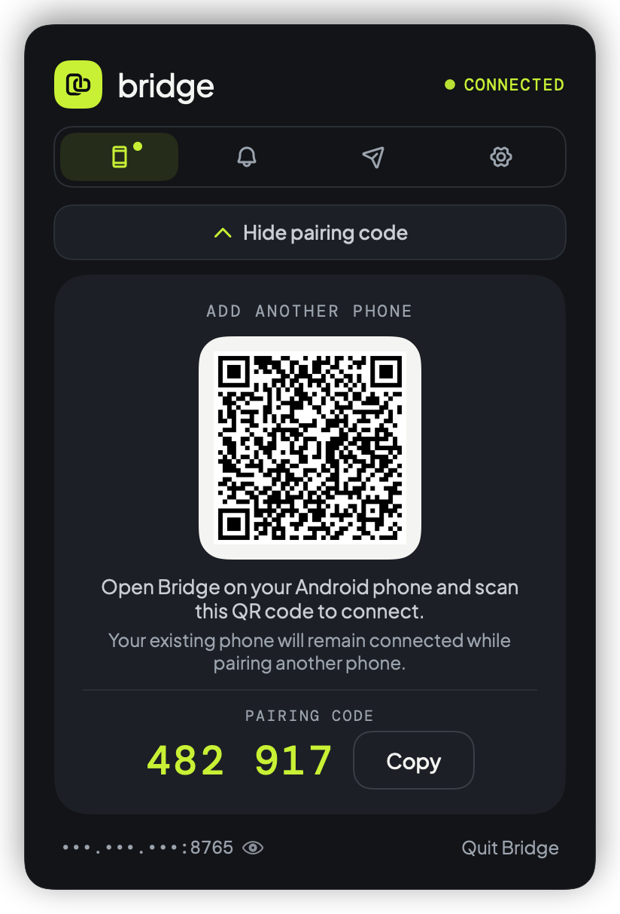
  <p><i>Expand "Add another phone" anytime to connect an additional device.</i></p>
</div>

---

## 🔒 Security, Privacy & Architecture Transparency

Bridge is built to be **100% local, zero-cloud, and auditable** (see [SECURITY.md](SECURITY.md) for full cryptographic specifications).

### 1. 2048-Bit SPEKE PAKE Authentication & End-to-End AES-256-GCM Transport
* **Zero-knowledge PAKE handshake (`BridgeSpeke`):** Devices authenticate using a 2048-bit **SPEKE (Simple Password Exponential Key Exchange)** over RFC 3526 Group 14 ($p = 2q + 1$). Neither the 6-digit pairing code nor any static hash of it is sent before Diffie-Hellman key agreement, preventing offline brute-force attacks against recorded handshakes and providing **Perfect Forward Secrecy (PFS)**.
* **Encrypted control, file & mirroring channels (`BridgeSessionCipher`, `PhoneMirrorStreamCipher`):** All post-handshake traffic on `TCP :8765` (clipboard text/images, notifications, call events/actions, media/device controls, mirror control/input, and file-transfer headers) is encrypted with directional **AES-256-GCM** keys, monotonic 64-bit sequence numbers, and AAD direction binding. Dedicated file-transfer streams and Phone Mirroring H.264 video sockets are likewise encrypted per-packet with **AES-256-GCM**, authenticated via one-way SHA-256 session proofs (`computeDataSocketAuth` / `computeStreamAuthProof`), and strictly isolated to local LAN interfaces.

### 2. Brute-Force & Denial-of-Service Defense
* **Per-IP Exponential Lockout:** 5 failed handshake attempts from an IP within 60 seconds trigger an immediate 60-second lockout, doubling exponentially on consecutive violations up to 960 seconds.
* **Global Rate-Limiting:** 10 failed handshake attempts across all IPs within 60 seconds trigger a 30-second global handshake lockout.
* **Anti-Replay Nonce Caching:** Caches the most recent 256 handshake nonces to reject replayed `hello` packets.
* **Unauthenticated Handshake Timeout:** Connections that do not authenticate within 8 seconds are automatically dropped.
* **Bounded Buffers:** Unauthenticated connections are restricted to 8 KB max payload size (and max 4 concurrent unauthenticated sockets) to mitigate memory exhaustion and socket DoS.

### 3. Local Network Boundary Enforcement
* Bridge rejects connections originating from public or non-private IP addresses.
* Only local LAN addresses (RFC 1918: `10.0.0.0/8`, `172.16.0.0/12`, `192.168.0.0/16`, link-local `169.254.0.0/16`, CGNAT `100.64.0.0/10`, and loopback/link-local IPv6) are accepted.
* Pairing codes on macOS are stored with strict POSIX `0600` permissions (`~/.bridge_pairing_code`).

### 4. File Transfer & Archive Extraction Safeguards
* **Protected Session Tokens & Data-Socket Auth Proofs:** Per-transfer 256-bit `token` values travel exclusively inside the AES-256-GCM encrypted `:8765` control channel, and dedicated data sockets authenticate using a one-way SHA-256 binder (`computeDataSocketAuth`) instead of exposing the raw token.
* **Executable & Script Confirmation Guard:** Even when incoming file auto-accept is enabled, both macOS and Android always prompt for manual confirmation before accepting executable, script, bundle, or shortcut files (`.app`, `.command`, `.workflow`, `.scpt`, `.sh`, `.py`, `.jar`, `.webloc`, `.apk`, `.dmg`, `.pkg`, `.exe`, `.dylib`, etc.) as well as folder archives.
* **Path Traversal & Symlink Protection:** Incoming filenames and archive entries are sanitized (`sanitizeFileName`), and folder archive extraction rejects symbolic links to prevent symlink escapes.

### 5. Transparent Permission Usage

| Permission | Exact Purpose in Bridge | Source Reference |
| :--- | :--- | :--- |
| `BIND_NOTIFICATION_LISTENER_SERVICE` | Reads incoming Android status bar notifications & live calls to mirror to your Mac and delivers replies, dismissals, or call actions back to apps. | [`BridgeNotificationListenerService.kt`](android-app/app/src/main/java/com/link/clipboardsync/BridgeNotificationListenerService.kt) |
| `BIND_ACCESSIBILITY_SERVICE` | Detects copy events on Android 10+ and executes gestures/text input during active Phone Mirroring sessions. Does not read private content or log keystrokes outside active mirroring/copy events. | [`ClipboardSyncAccessibilityService.kt`](android-app/app/src/main/java/com/link/clipboardsync/ClipboardSyncAccessibilityService.kt) |
| `FOREGROUND_SERVICE_MEDIA_PROJECTION` | Captures your display strictly while a user-approved **Mirror Phone** session is running and streams encrypted frames to your Mac. | [`ScreenMirrorForegroundService.kt`](android-app/app/src/main/java/com/link/clipboardsync/ScreenMirrorForegroundService.kt) |
| `ANSWER_PHONE_CALLS` & `READ_PHONE_STATE` | Enables cellular **Accept** / **End Call** actions and ringing state detection when **Calls on Mac** is enabled. | [`PhoneCallMonitor.kt`](android-app/app/src/main/java/com/link/clipboardsync/PhoneCallMonitor.kt) |
| `ACCESS_NOTIFICATION_POLICY` & `MODIFY_AUDIO_SETTINGS` | Powers remote **Ringer Mode**, **Do Not Disturb**, active call **Mute**, media volume, and **Ring Phone** finder controls from your Mac. | [`PhoneControlManager.kt`](android-app/app/src/main/java/com/link/clipboardsync/PhoneControlManager.kt) |
| `INTERNET` | Establishes local LAN sockets (`:8765`, transfer & mirror streams) between phone and Mac. Queries GitHub Releases for app updates. | [`NetworkSyncClient.kt`](android-app/app/src/main/java/com/link/clipboardsync/NetworkSyncClient.kt) |
| `CAMERA` | Active only when scanning the pairing QR code. Video frames are decoded in memory and discarded immediately. | [`MainActivity.kt`](android-app/app/src/main/java/com/link/clipboardsync/MainActivity.kt) |
| `POST_NOTIFICATIONS` | Displays the persistent foreground notification, file transfer progress alerts, and active mirroring controls. | [`ClipboardSyncForegroundService.kt`](android-app/app/src/main/java/com/link/clipboardsync/ClipboardSyncForegroundService.kt) |
| `REQUEST_IGNORE_BATTERY_OPTIMIZATIONS` | Prevents Android Doze mode from killing the socket connection when the device is locked. | [`MainActivity.kt`](android-app/app/src/main/java/com/link/clipboardsync/MainActivity.kt) |

---

## 🤝 Contributing

Contributions, bug reports, and suggestions are welcome! Feel free to open an issue or submit a pull request.

## 📄 License

Released under the [MIT License](LICENSE).
