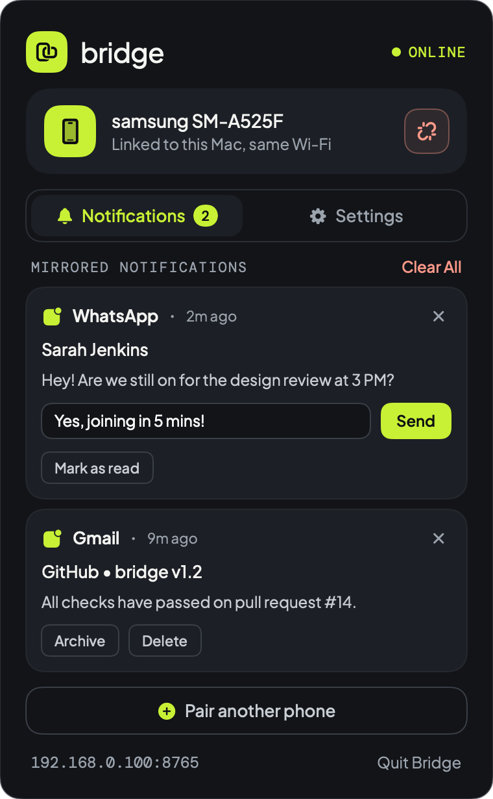
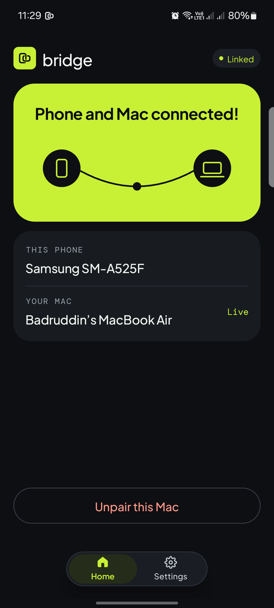
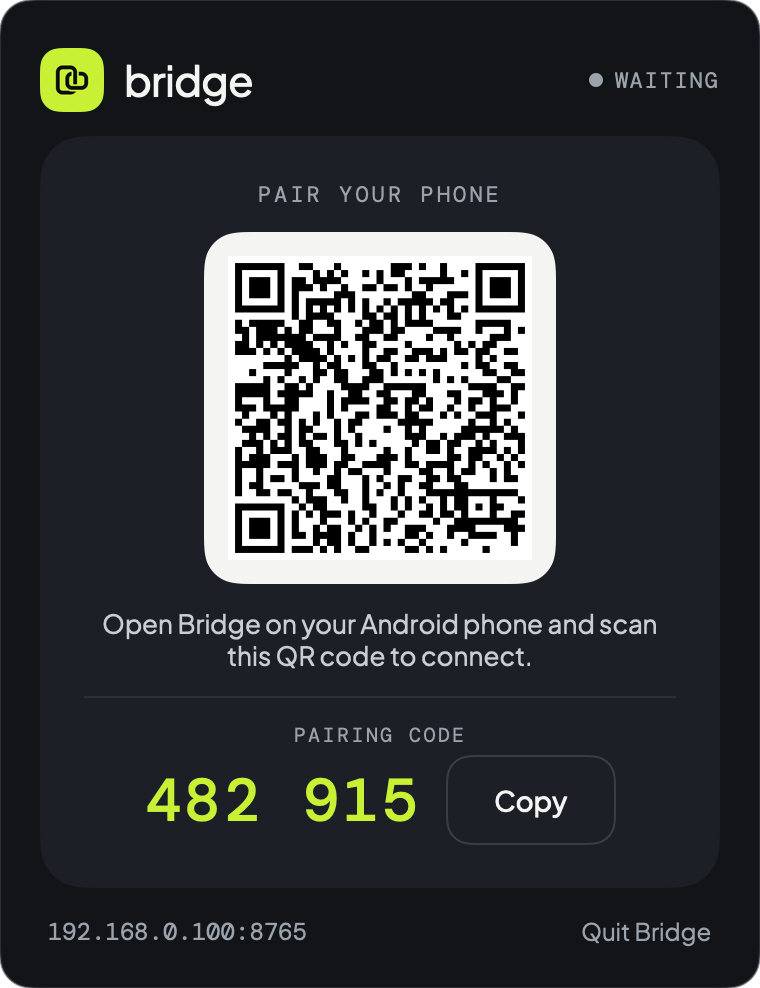
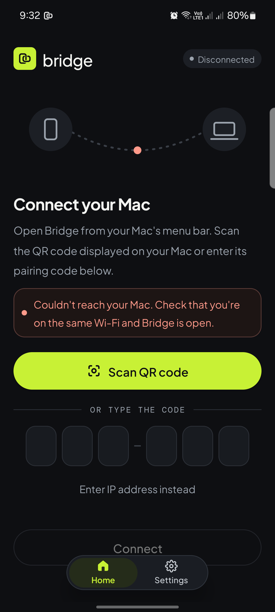
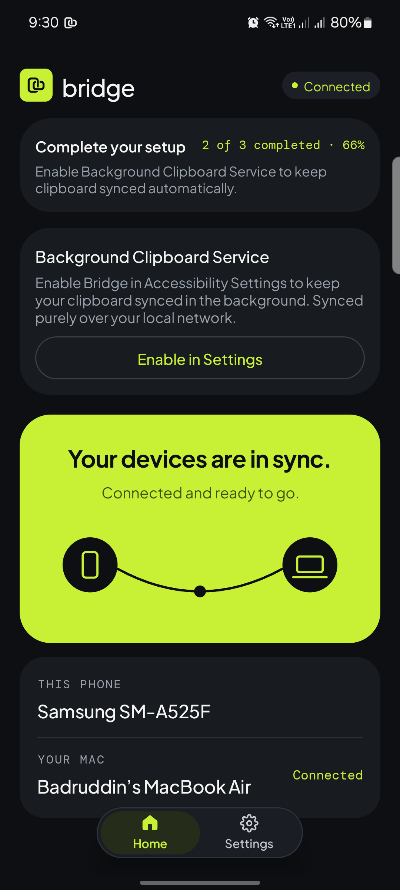
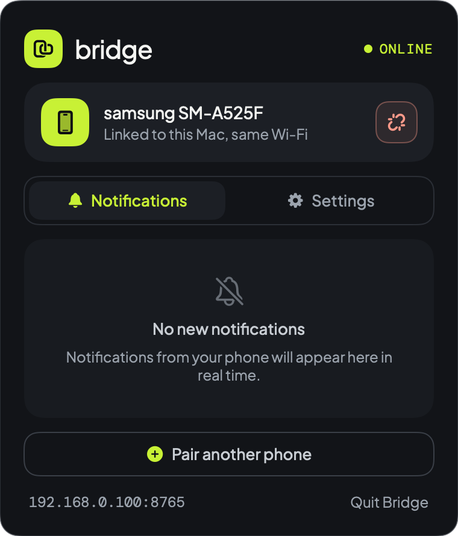
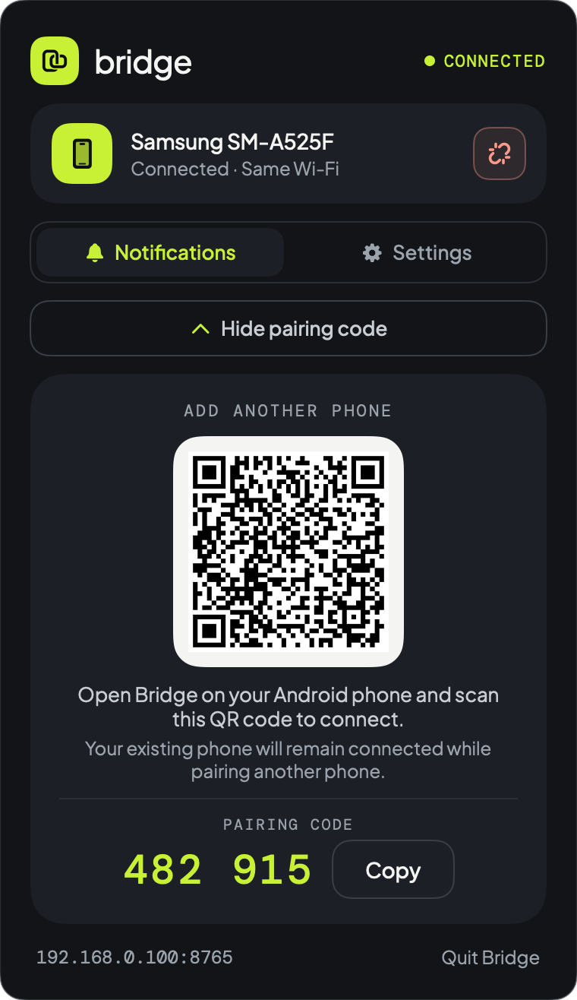

<div align="center">


# bridge

### **Android and Mac, seamlessly connected.**

A lightweight, native open-source bridge linking your **Android phone** and your **Mac** over your local Wi-Fi network—with zero cloud accounts, zero telemetry, and zero latency.

<p align="center">
  
  
  
  
  <a href="LICENSE"></a>
</p>

<p align="center">
  <a href="#-whats-new-in-v130">What's New in v1.3.0</a> •
  <a href="#-key-features">Key Features</a> •
  <a href="#-getting-started">Getting Started</a> •
  <a href="#-pairing--multi-device-connection">Pairing & Multi-Device</a> •
  <a href="#-security-privacy--permissions-transparency">Security & Privacy</a>
</p>

<table align="center">
  <tr>
    <td align="center"><b>macOS Menu Bar App (Interactive Notifications)</b></td>
    <td align="center"><b>Android App (Floating Pill Navigation)</b></td>
  </tr>
  <tr>
    <td align="center"></td>
    <td align="center"></td>
  </tr>
</table>

</div>

---

> [!NOTE]
> **Active Open-Source Project**  
> Bridge is an actively maintained open-source project updated on a regular basis with continuous stability enhancements, new features, and design improvements. Star the repository to follow releases and upcoming roadmap milestones.

---

## ⚡ What's New in v1.3.0

Bridge **v1.3.0** introduces high-speed local file & folder sharing and conversation-grouped notification threads:

1. **High-Speed Encrypted Local File & Folder Sharing:**
   - **🚀 Direct Gigabit LAN Streaming:** Transfer files and full folder directories directly between Mac and Android over your local Wi-Fi or Personal Hotspot with zero cloud intermediate and zero internet data usage.
   - **📦 No File Size Limits:** Send 4K video clips, raw photo shoots, and large archive collections without artificial size caps.
   - **🛡️ Hardware-Accelerated AES-GCM:** Every frame is encrypted end-to-end (128-bit authentication tag, 12-byte random nonce per frame) with SHA-256 integrity verification.
   - **📂 Clean Recursive Folder Sharing:** Full folder structures are preserved and packaged with fast deflate compression, automatically filtering out OS metadata junk (`.DS_Store`, `__MACOSX`, `Thumbs.db`, `.Trashes`).
   - **📁 Custom Save Directories:** Choose custom save locations on Android (via SAF) and macOS (via Security-Scoped Bookmarks).
   - **🖱️ Native OS Integration:** Drag & drop onto the Mac menu bar icon, right-click any file in Finder (*Quick Actions → Share with Bridge*), or tap *Share → Send to Mac (Bridge)* in Android apps.

2. **Conversation-Grouped Notification Threads:**
   - Multi-line conversation cards displaying the full chat thread in chronological order, matching Android's expanded notification panel.
   - Message count pill badges indicating unread counts per contact or group chat.
   - Seamless two-way interaction: dismissing or replying on either device synchronizes instantly in real-time.

---

## ✨ Key Features

### 📁 High-Speed Encrypted Local File & Folder Sharing
* **Unlimited Transfers:** Transfer single files, batches, or full directory structures directly between Mac and Android with zero file size limits.
* **Direct LAN Stream:** Transfers stream straight across your local network or hotspot with hardware-accelerated AES-GCM encryption and post-transfer SHA-256 verification.
* **Folder Structure Integrity:** Directories are packaged cleanly without OS metadata (`.DS_Store`, `__MACOSX`, `Thumbs.db`) using fast deflate compression.
* **Native OS Shortcuts:** Drag and drop onto the macOS menu bar icon, right-click in Finder to "Share with Bridge", or share from Android's system share sheet (`ACTION_SEND`).
* **Custom Save Locations:** Choose your custom downloads folder on both Mac (via persistent Security-Scoped Bookmarks) and Android (via Storage Access Framework).

### 📋 Two-Way Clipboard Synchronization (Text & Photos)
* **Instant Text Copy:** Copy any text, code snippet, or link on your phone or Mac; immediately paste it on the other device with zero extra taps.
* **Screenshot & Image Sync:** Copy an image in Preview, capture a macOS screenshot (`Cmd+Shift+4`), or copy a photo on Android—it syncs directly into the other device's pasteboard.
* **Echo Suppression:** Robust SHA-256 digest hashing prevents infinite clipboard feedback loops.

### 🔔 Interactive Notification Mirroring
* **Instant Forwarding:** Phone notifications appear instantly in the macOS menu bar popover and as native macOS notification banners with app icons.
* **Inline Quick Reply:** Type and send replies directly to messages without touching your phone.
* **Smart Filtering:** Persistent background services and duplicate group summaries are automatically filtered out to keep your Mac feed clean.
* **Bidirectional Settings Sync:** Toggle notification sync on either phone or Mac with changes synchronized across both devices in real time.
* **Mac Alert Mirroring:** Optionally forward Mac system notifications to your Android device with smart duplicate detection (drops alerts for apps already installed on your phone).

### ⚡ Seamless Local Connectivity
* **Zero-Config Bonjour Discovery:** Discovers your Mac automatically on Wi-Fi via mDNS (`_clipboardsync._tcp`), adapting seamlessly to DHCP router changes.
* **Sleep & Wake Resilience:** Automatically pauses when your MacBook lid closes and re-establishes the connection within 1.5 seconds upon waking.
* **100% Local Wi-Fi:** All communication travels strictly over your local router on `TCP :8765`. Zero cloud servers, zero third-party accounts, zero tracking.

### 📱 Multiple Device Connectivity
* **One Mac, Multiple Phones:** Keep your personal and work phones linked to your MacBook at the same time.
* **Unified Feed:** Notifications from both devices are displayed with individual device tags.
* **Selective Unpairing:** Unpair or disconnect one phone without affecting other active devices.

---

## 🚀 Getting Started

You can install Bridge by downloading the pre-built binaries from [**GitHub Releases**](../../releases), using terminal commands, or building from source.

### Option 1: Direct Download

1. Download the latest **`v1.3.0`** release assets from [**Releases**](../../releases):
   - 💻 **`Bridge-v1.3.0-macOS.zip`** — Native macOS Menu Bar App (`macOS 11.0+`)
   - 📱 **`Bridge-v1.3.0-Android.apk`** — Native Android App (`Android 8.0+`)
2. **Install on macOS:**
   - Unzip `Bridge-v1.3.0-macOS.zip` and move **`Bridge.app`** into `/Applications`.
   - Launch **`Bridge.app`**. *(If macOS Gatekeeper prompts on first launch, right-click `Bridge.app` → **Open**, or run `xattr -cr /Applications/Bridge.app && open /Applications/Bridge.app` in Terminal).*
   - The Bridge icon will appear in your top menu bar.
3. **Install on Android:**
   - Open **`Bridge-v1.3.0-Android.apk`** on your Android phone to install the app.

---

### Option 2: Install via Command Line (CLI)

```bash
# 1. Download & launch the macOS Menu Bar app
curl -L -o /tmp/Bridge-macOS.zip "https://github.com/badruddin-tasnim/bridge/releases/download/v1.3.0/Bridge-v1.3.0-macOS.zip"
unzip -q -o /tmp/Bridge-macOS.zip -d /Applications
xattr -cr /Applications/Bridge.app
open /Applications/Bridge.app

# 2. Download & install the Android APK over ADB
curl -L -o /tmp/Bridge-Android.apk "https://github.com/badruddin-tasnim/bridge/releases/download/v1.3.0/Bridge-v1.3.0-Android.apk"
adb install -r /tmp/Bridge-Android.apk
```

---

### Option 3: Build from Source

<details>
<summary><b>Click to expand build instructions (Swift & Gradle)</b></summary>

#### Prerequisites
- **macOS:** macOS 11.0+ with Xcode Command Line Tools (`xcode-select --install`)
- **Android:** JDK 17+ and Android SDK (`compileSdk 34`)

#### Build macOS Menu Bar App
```bash
cd mac-app
make clean && make
make install   # Installs Bridge.app to /Applications/Bridge.app
make run       # Launches Bridge in your menu bar
```

#### Build Android App
```bash
cd android-app
./gradlew assembleDebug
adb install -r app/build/outputs/apk/debug/app-debug.apk
```
</details>

---

## 🔗 Pairing & Multi-Device Connection

Pairing your devices is fast, private, and requires zero account creation:

<table align="center">
  <tr>
    <td align="center" width="50%"><b>Step 1: Open Mac Menu Bar</b></td>
    <td align="center" width="50%"><b>Step 2: Scan QR or Enter Code on Phone</b></td>
  </tr>
  <tr>
    <td align="center"></td>
    <td align="center"></td>
  </tr>
  <tr>
    <td align="center" width="50%"><b>Step 3: Enable Permissions</b></td>
    <td align="center" width="50%"><b>Step 4: Connected & Ready</b></td>
  </tr>
  <tr>
    <td align="center"></td>
    <td align="center"></td>
  </tr>
</table>

### Step-by-Step Instructions:

1. **Connect to Same Wi-Fi:** Ensure your Android phone and Mac are connected to the same local Wi-Fi network. *(Tip: When traveling or away from home, you can also connect your Mac directly to your phone's Personal Hotspot).*
2. **Open Bridge on Mac:** Click the **Bridge** icon in your Mac menu bar. It displays your instant QR code and 6-digit code.
3. **Scan or Type Code on Android:**
   - Tap **Scan QR code** in the Android app and point your camera at the Mac menu bar popover.
   - *Alternatively:* Enter the 6-digit pairing code shown on your Mac.
   - *Manual IP:* If on an enterprise network blocking multicast (mDNS), tap **Enter IP address manually** and input the `IP:port` shown in the bottom bar of the Mac popover.
4. **Grant Permissions on Android:**
   - **Notification Access:** Allows Bridge to mirror your incoming notifications and route quick replies.
   - **Accessibility Service:** Android 10+ restricts background apps from reading the clipboard. Bridge uses an accessibility event listener to capture copy actions without screen reading or keylogging.
   - **Battery Optimization Exemption:** Prevents OEM task killers from freezing background sync when your phone is locked.
5. **Adding Another Phone:**
   - Click **Add another phone** in the Mac popover anytime.
   - The QR drawer expands smoothly without disconnecting your existing device.
   - Scan with your second device to link both phones simultaneously!

<div align="center">
  
  <p><i>Expand "Add another phone" anytime to connect an additional device.</i></p>
</div>

---

## 🔒 Security, Privacy & Architecture Transparency

Bridge is built from the ground up to be **100% private, local, and auditable**.

### 1. Zero-Knowledge Nonce-Hashed Authentication
* Pairing codes are **never transmitted in plaintext** across the network.
* Handshake authentication uses a challenge-response scheme:
  $$\text{Proof} = \text{SHA-256}(\text{"bridge-hello:"} + \text{PairingCode} + \text{":"} + \text{ClientNonce})$$
* Mutual authentication: The Mac verifies the client's proof and responds with a matching salted welcome proof before any data socket is authorized.

### 2. Brute-Force & Denial-of-Service Defense
* **Per-IP Exponential Lockout:** 5 failed handshake attempts from an IP results in an immediate 15-second lockout, doubling on each subsequent violation up to 240 seconds.
* **Global Rate-Limiting:** Coordinated attempts trigger a 30-second global handshake halt.
* **Anti-Replay Nonce Caching:** Prevents replay attacks by invalidating reused authentication nonces.
* **Unauthenticated Handshake Timeout:** Connections that do not authenticate within 8 seconds are automatically dropped.
* **Bounded Buffers:** Unauthenticated connections are restricted to 8 KB max payload size to eliminate buffer overflow and socket exhaustion attacks.

### 3. Local Network Boundary Enforcement
* Bridge rejects connections originating from public or non-private IP addresses.
* Only local LAN addresses (RFC 1918: `10.0.0.0/8`, `172.16.0.0/12`, `192.168.0.0/16`, link-local `169.254.0.0/16`, and loopback) are accepted.
* Pairing secrets are stored with strict POSIX `0600` permissions (`~/.bridge_pairing_code`).

### 4. Transparent Permission Usage

| Permission | Exact Purpose in Bridge | Source Reference |
| :--- | :--- | :--- |
| `BIND_NOTIFICATION_LISTENER_SERVICE` | Reads incoming Android status bar notifications to mirror them to your Mac and delivers replies/dismissals back to apps. | [`BridgeNotificationListenerService.kt`](android-app/app/src/main/java/com/link/clipboardsync/BridgeNotificationListenerService.kt) |
| `BIND_ACCESSIBILITY_SERVICE` | Detects copy events on Android 10+ so clipboard text can be synced without background polling. Does not read screen text or log keystrokes. | [`ClipboardSyncAccessibilityService.kt`](android-app/app/src/main/java/com/link/clipboardsync/ClipboardSyncAccessibilityService.kt) |
| `INTERNET` | Establishes the local LAN TCP socket (`:8765`) between phone and Mac. Checks GitHub API for new releases. | [`NetworkSyncClient.kt`](android-app/app/src/main/java/com/link/clipboardsync/NetworkSyncClient.kt) |
| `CAMERA` | Active only when scanning the pairing QR code. Video frames are decoded in memory and discarded immediately. | [`MainActivity.kt`](android-app/app/src/main/java/com/link/clipboardsync/MainActivity.kt) |
| `POST_NOTIFICATIONS` | Displays the persistent foreground notification required by Android to keep the background sync engine alive. | [`ClipboardSyncForegroundService.kt`](android-app/app/src/main/java/com/link/clipboardsync/ClipboardSyncForegroundService.kt) |
| `REQUEST_IGNORE_BATTERY_OPTIMIZATIONS` | Prevents Android Doze mode from killing the socket connection when the device is locked. | [`MainActivity.kt`](android-app/app/src/main/java/com/link/clipboardsync/MainActivity.kt) |

---

## 🤝 Contributing

Contributions, bug reports, and suggestions are welcome! Feel free to open an issue or submit a pull request.

## 📄 License

Released under the [MIT License](LICENSE).
